# Fusion for foobar2000

Fusion is a foobar2000 skin inspired by Xbox Music. 
Albums are a grid you can open in place, artists and genres get 
their own pages, and the player sits along the bottom. It runs as a theme for
[foo_ui_webview2](https://github.com/NereaFantasia/foo_ui_webview2) on
foobar2000 v2, 64-bit included.


It began as a rebuild of
[Fusion v2.4.1.1 by NadirP](https://web.archive.org/web/20150926162833/http://nadirp.deviantart.com/art/Fusion-v2-4-1-1-Discontinued-Project-464482526).
The original was discontinued in 2015 and depended on WSH Panel Mod and UI
Hacks, which were never made for 64-bit foobar2000. Version 3 keeps its look
and layout but is written from scratch, runs a lot faster, and does quite a bit more.

## Albums

The playlist you're viewing, as covers. Click one and it opens underneath,
with its songs over a blurred copy of the cover. Albums with more than one disc
get a row of discs, each with its own cover and subtitle.

The Collection opens on a few shelves: recently added, recently played, most
played, albums you haven't played in a while, ones you've never played, and a
random set that changes daily. You pick which shelves show and in what order.

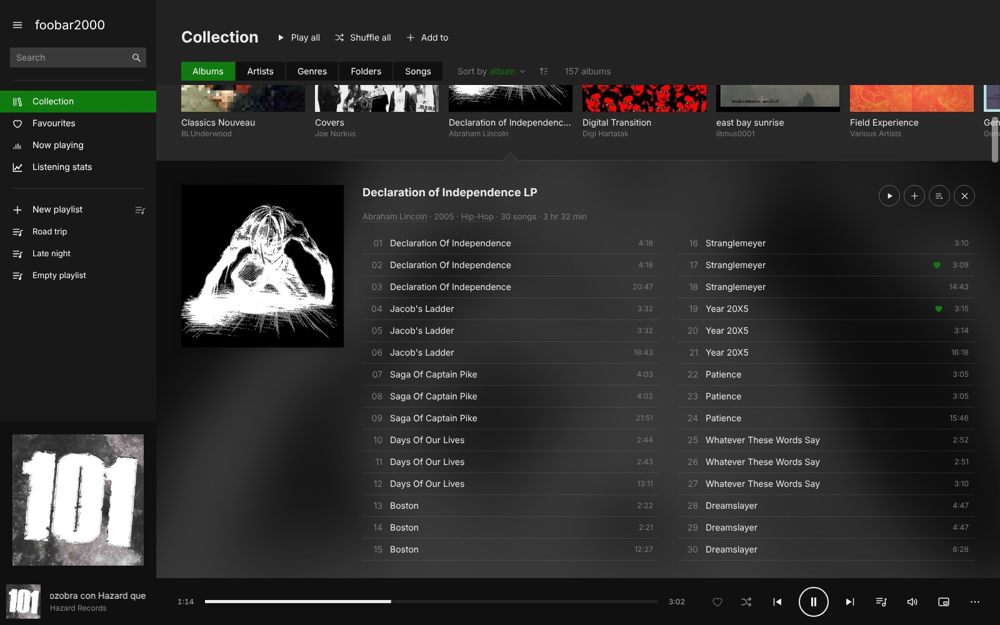

Behind an opened album goes its cover, blurred, or a background and text
colours picked from the cover. Or nothing, if you'd rather.

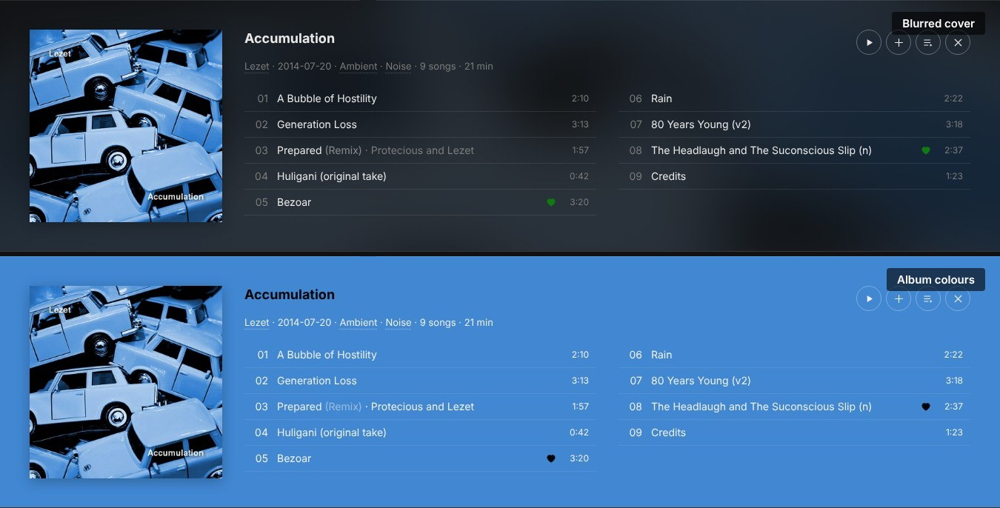

## Artists and genres

Each artist gets a tile. Fusion reads the ARTISTS tag, so featured artists
appear as well. An artist's page has their picture, logo, biography and
backdrop, then their albums.

Genres work the same way (split on `;`). A genre's page shows its picture, or
a collage of its biggest albums, with a description, the genre it comes from
and what it led to.

The pictures and text are Kodi-style files in a folder per artist or genre
(`artist.nfo`, `artist.jpg`, `fanart.jpg`, `logo.png`). The
`fusion-artist-info.py` script fills those in for your whole library from
MusicBrainz, Wikipedia, TheAudioDB and fanart.tv, and Fusion can run it for
you. You can also edit an artist or genre in Fusion and paste or drop pictures
straight in.

| | |
|---|---|
|  | 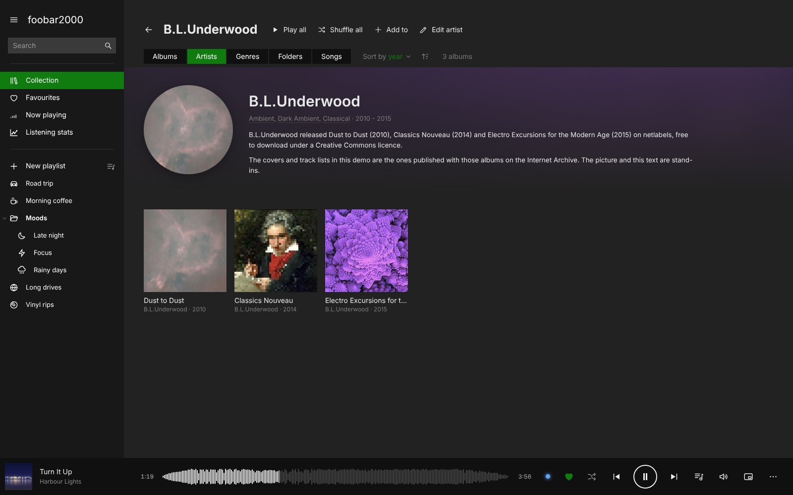 |
| 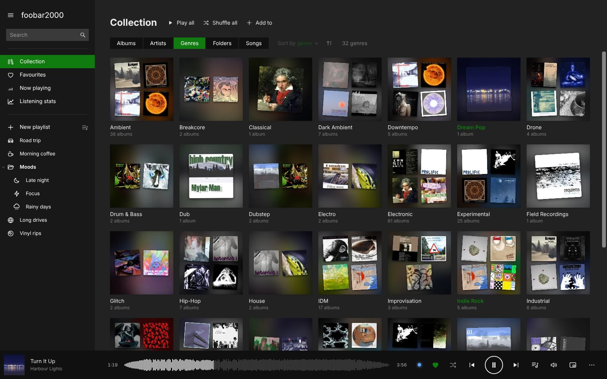 |  |

## Folders and songs

Folders is your music as it sits on disk, as a tree.

Songs is a list with whatever columns you like, including your own title
formatting patterns. Click a column's header to sort by it, and again to
reverse. A column of your own can sort by a different pattern from the one it
shows: below, a Quality column shows "24/96" or "320kbps" but sorts DSD first,
then lossless, then lossy, best first within each.

| | |
|---|---|
| 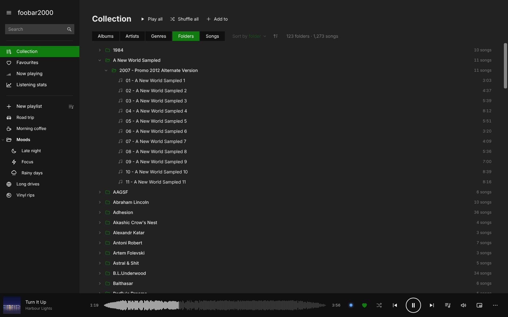 |  |

## Now playing and shuffle

Now playing has the cover large, over the album's colours, with the queue and
what's coming up underneath.

When you shuffle, Fusion keeps its own order and queues one song ahead, so
the next 50 are always listed and you can drag them around. Right-click a song
to play from there. Songs you queue yourself play next, and then the shuffle
carries on where it was. Previous goes back through the last 50 songs you
played, not to a random one.


The panel on the right has the song's details, its tags, the technical side,
ReplayGain and lyrics. Lyrics come from foo_openlyrics. Timed lyrics scroll
along with the song, and clicking a line jumps there.


## Signal path

The dot beside the seek bar shows what happens to the sound between the file
and your DAC: the source, ReplayGain, each DSP and whether it actually changes
this song, the volume, and the output. Its colour sums it up: bit-perfect,
processed, converted, or a lossy source. DSD that goes straight to the DAC,
natively or as DoP, shows as skipping all of that.

With the foo_outinfo component installed, it also shows the format really
going to the output and the ReplayGain that was applied.

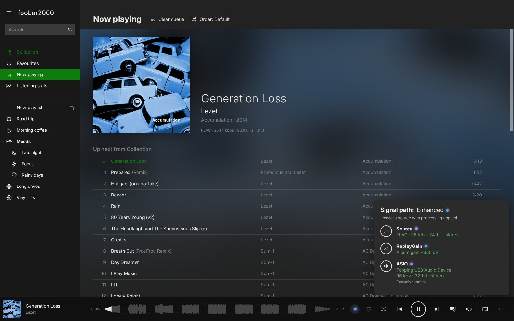

## Listening stats

Totals, top artists, genres, albums and songs, plays by month and by time of
day, and favourites you've stopped playing. It reads foo_playcount, and
foo_enhanced_playcount if you have it (the time-of-day chart needs that).
Everything on the page can be clicked through to or right-clicked.

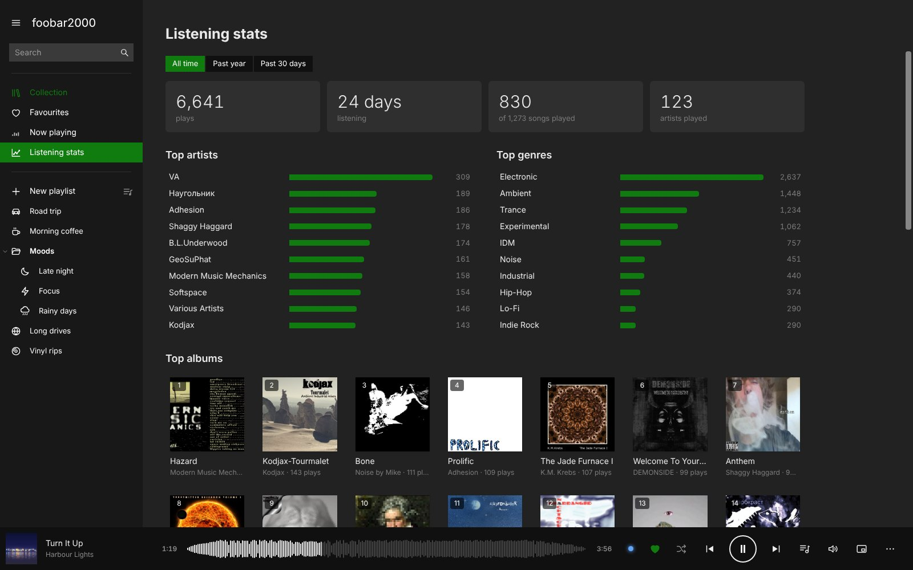

## Playlists

The playlist manager (Ctrl+M) replaces the Default UI one. Drag playlists to
reorder them, put them in folders, give them icons, and drop albums or songs
on one to add them. The autoplaylist editor suggests fields, operators and
values from your library as you type, and counts the matching songs.

| | |
|---|---|
| 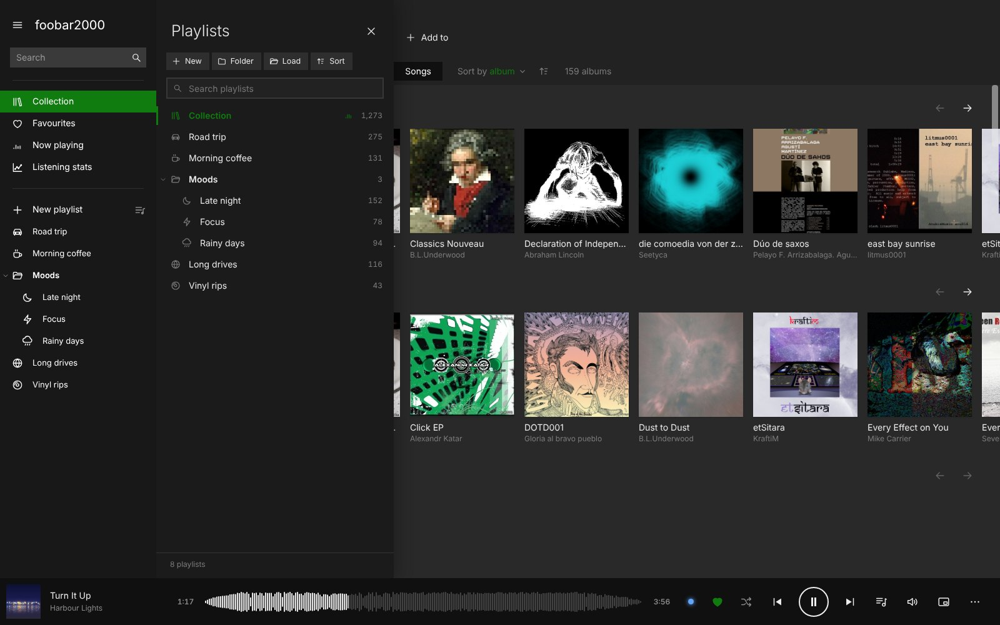 |  |

## Settings

Light or dark, any accent colour, tile sizes, which shelves to show, what goes
behind an opened album, and a waveform seek bar.

| | |
|---|---|
|  | 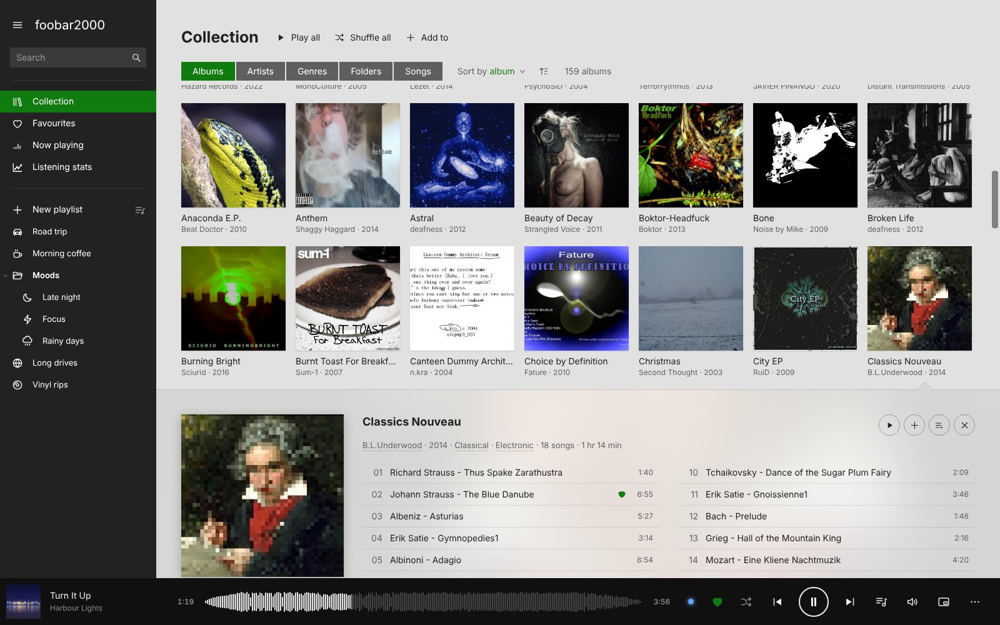 |

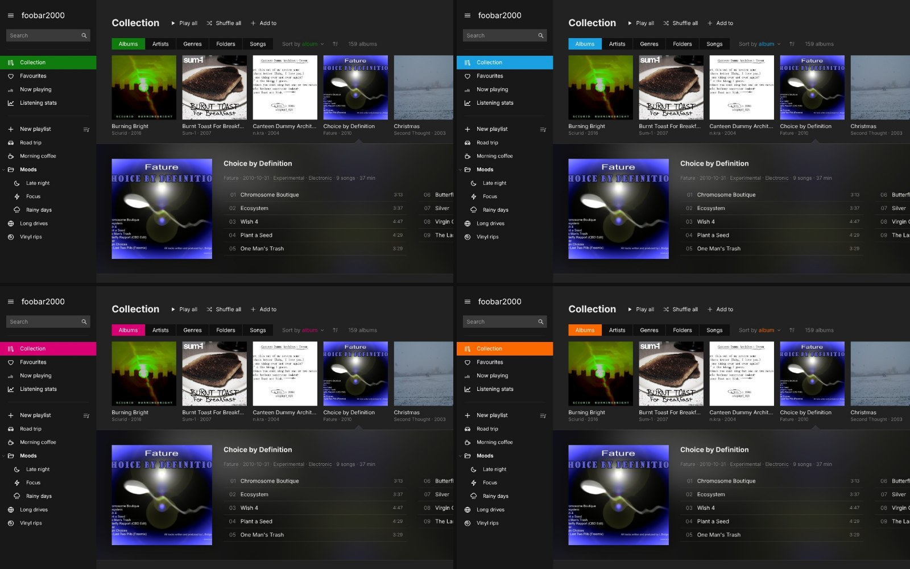

## Mini player

Alt+M, or the button in the play bar, shrinks the window to the cover, the
song and its controls, and keeps it on top of other windows if you want. Alt+M
again brings the full window back.

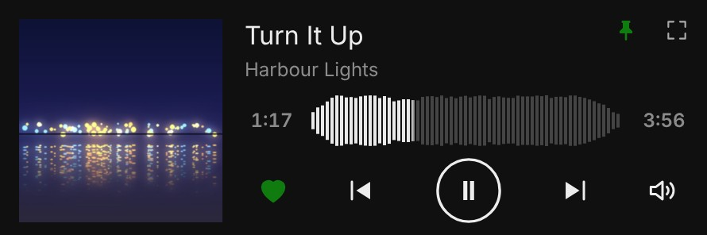

## Also

- Likes and dislikes. The heart on a song cycles through Like it, Hate it and
  nothing, kept in the `MOOD` tag as the original skin did. Favourites lists
  what you liked.
- Original, English and romanised titles for music tagged that way (the
  Language Variants plugin for Picard, in
  [PicardPlugins](https://github.com/FooThemes/PicardPlugins), writes those
  tags). You pick which one leads.
- Search within whatever you're looking at.
- foobar2000's own context menu on songs and albums, and its main menu (the
  menu bar itself is hidden).
- On ASIO, pausing can hand the device back to Windows so other programs can
  play, and resumes where you left off (Settings → Layout → Pause releases
  ASIO).
- Covers are cached on disk as small WebP files, so they load at once after
  the first time.

## Requirements

- Windows 10 or 11 (both come with the WebView2 runtime)
- [foobar2000](https://www.foobar2000.org/download) v2.0 or later
- [foo_ui_webview2](https://github.com/NereaFantasia/foo_ui_webview2/releases)
  v2.1 or later

Optional:

- [foo_playcount](https://www.foobar2000.org/components/view/foo_playcount)
  for play counts, the shelves and Listening stats
- [foo_enhanced_playcount](https://www.foobar2000.org/components/view/foo_enhanced_playcount)
  for the time-of-day chart
- [foo_openlyrics](https://www.foobar2000.org/components/view/foo_openlyrics)
  for lyrics
- [foo_outinfo](https://foobar.hyv.fi/?view=foo_outinfo) for the output side
  of the signal path

## Install

The easy way: download `fusion-<version>.zip` from [Releases](../../releases),
extract it anywhere and run **install.bat**. It:

- finds foobar2000 (portable or standard install; it asks if there's more than
  one)
- installs foo_ui_webview2 if it's missing or too old, downloading it from its
  GitHub releases (or using a `.fb2k-component` you put next to install.bat)
- copies Fusion into the profile's `webview-ui\fusion` folder, keeping the
  cover cache if Fusion was already there
- backs up whatever it replaces to `<profile>\fusion-backup\<date>\`, along
  with an **uninstall.bat** that puts it all back
- offers to install each optional component you don't have yet (downloaded
  from foobar2000.org, or from the author's site for foo_outinfo)

foobar2000 has to be closed while it runs. On a first install you then do
steps 3 and 4 below.

By hand:

1. Install foo_ui_webview2: **File → Preferences → Components → Install…**,
   pick the `.fb2k-component` file, then restart foobar2000.
2. Extract the `fusion` folder from the zip into your profile's `webview-ui`
   folder, so you end up with `webview-ui\fusion\index.html`.
   - Portable install: `<foobar2000 folder>\profile\webview-ui\fusion\`
   - Standard install: `%APPDATA%\foobar2000-v2\webview-ui\fusion\`
3. **File → Preferences → Display → Default User Interface**: choose
   **WebView2 UI**.
4. WebView2 UI's own page has no menu bar, so right-click anywhere and choose
   **File → Preferences…**. Then **Display → WebView2 UI**: set the template
   to **fusion** and click **Apply**.

The first time it runs, Fusion makes a **Collection** autoplaylist (your whole
library) unless you already have one.

The artist info script comes with Fusion, in `fusion\tools\artist-info\`,
and Fusion finds it there by itself (it's also in `fusion-tools-<version>.zip`
if you'd rather keep it somewhere else).
The Picard plugins (Language Variants, Genre Tidy and Only These Tags) are in
[FooThemes/PicardPlugins](https://github.com/FooThemes/PicardPlugins).

## Updating

Updating foobar2000 or foo_ui_webview2 leaves Fusion and its settings alone;
both live in your profile.

To update Fusion, run install.bat from the new zip, or extract the new zip's
`fusion` folder over `webview-ui\fusion\` and replace the files. Don't
delete the folder first, as the cover cache is in there. Then press
**Ctrl+Shift+F5** or restart foobar2000.

## Troubleshooting

- Fusion writes warnings and errors to `fusion.log` in your profile folder.
  **Settings → More → Open the log file** opens it.
- **Settings → More → Reset Fusion settings** puts everything back to the
  defaults. Your playlists and library aren't touched.
- Browser dev tools can be turned on in **Preferences → Display → WebView2 UI
  → Developer**.

## Development

There's no build step: it's plain ES modules that WebView2 loads directly.

```
index.html
css/          styles
js/core/      bridge to foobar2000, settings, icons, helpers
js/data/      player, playlists, the library view, artwork, title formatting
js/ui/        one module per part of the window
dev/          a stand-in for foobar2000, and the demo library
tools/        the artist info script
```

To work on it in a browser, serve the folder (`python -m http.server`) and
open `index.html`. With no foobar2000 around, `dev/mock-bridge.js` takes its
place with a made-up library. Like the real component, the mock refuses
parameters the API doesn't have; that list comes from the component's docs:

```
python dev/tools/extract-api.py <foo_ui_webview2>/docs/vitepress/api > dev/api-params.json
```

The screenshots use a demo library of Creative Commons albums instead (see
[the credits](docs/screenshots/CREDITS.md)). To get it and take them again:

```
python dev/demo/build.py          # downloads the albums into dev/demo/data/
python -m http.server 8765        # then open index.html?demo
node dev/demo/capture.js          # retakes the screenshots (needs Playwright)
```

## Releasing

Set the version in `js/version.js`, commit, then tag and push:

```
git tag v3.0.0
git push origin v3.0.0
```

The Release workflow builds both zips with `python dev/tools/release.py` and
attaches them. You can also make the release on GitHub's site instead of
pushing a tag (with or without the `v`). For a tag that's already there,
**Actions → Release → Run workflow** builds them. Tags with a `-` in them
(`v3.0.0-beta.2`) become pre-releases. Running the script yourself puts the
zips in `dist/`.

## Credits and licence

The original Fusion design is NadirP's. This version is released under the
MIT licence (see `LICENSE`) and contains none of the original skin's code or
images.
