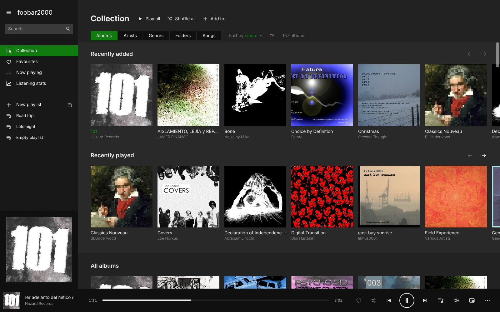
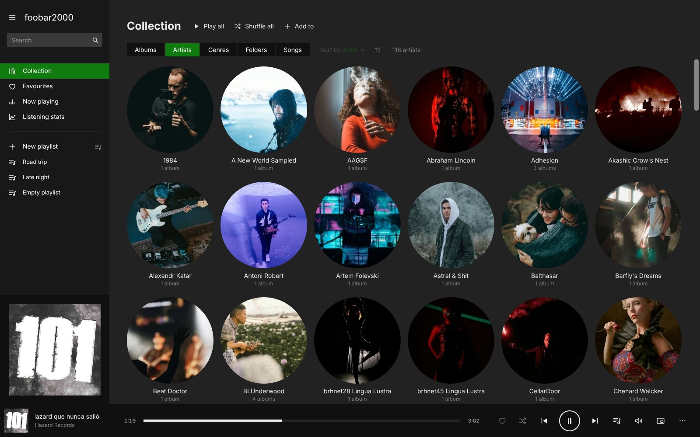
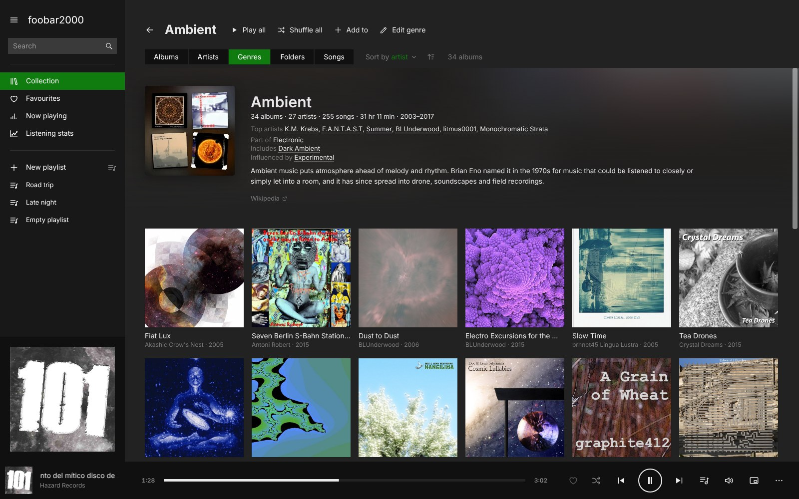
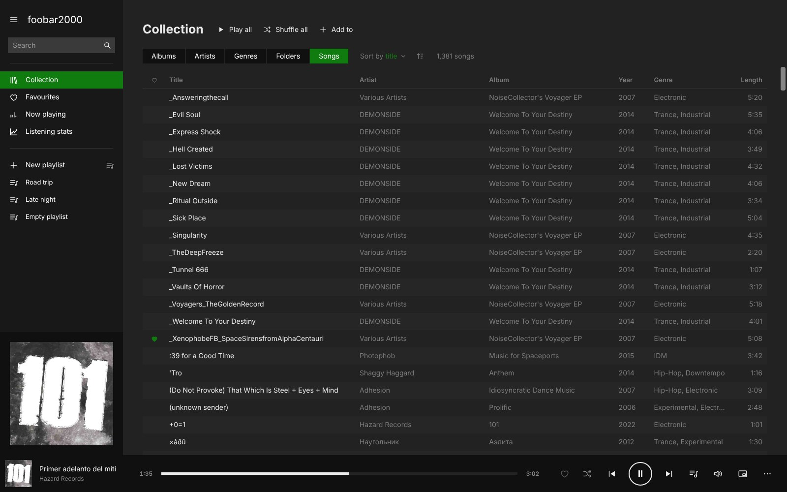
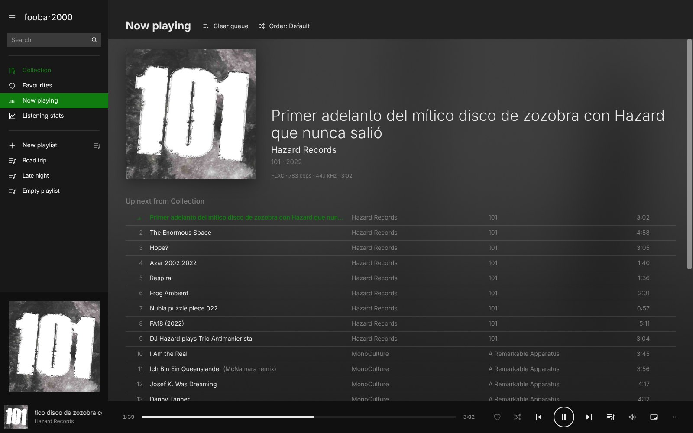
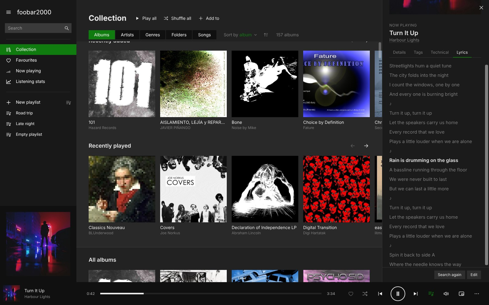
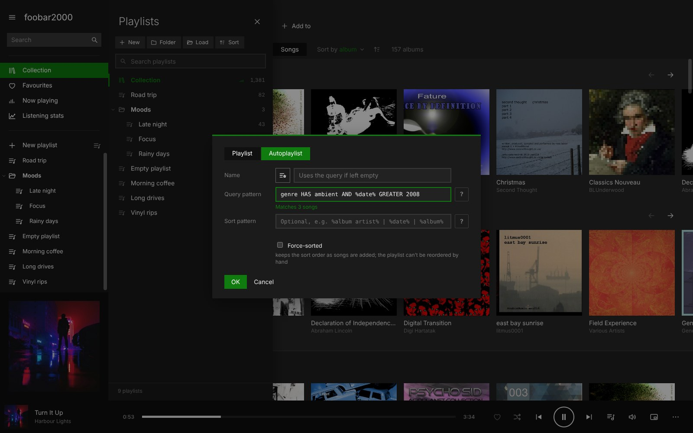
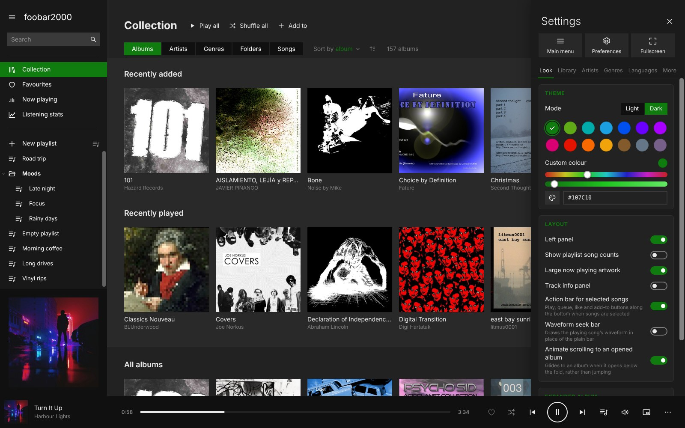

# Fusion for foobar2000

Fusion is a foobar2000 skin that puts your library first: albums as covers,
artists and genres with their own pages, and a player bar along the bottom.
It's a theme for the [foo_ui_webview2](https://github.com/NereaFantasia/foo_ui_webview2)
component and runs on foobar2000 v2, 64-bit included.



It started as a rebuild of [Fusion v2.4.1.1 by NadirP](https://web.archive.org/web/20150926162833/http://nadirp.deviantart.com/art/Fusion-v2-4-1-1-Discontinued-Project-464482526),
which was discontinued in 2015 and needed WSH Panel Mod and UI Hacks, neither of
which exists for 64-bit foobar2000. Version 3 keeps the original's look and
layout, but it's written from scratch and has grown a fair bit since.

## What's in it

### Albums

Every album in the playlist you're viewing, as a grid of covers. Click one and
it opens in place, with its songs laid out over a blurred copy of the cover.
Multi-disc albums get a disc bar with each disc's own cover and subtitle.

Above the grid are shelves: recently added, recently played, most played,
albums you haven't heard in a while, never played, and a daily random pick.
You choose which ones show, and in what order.


### Artists and genres

Artists get a tile each, using the ARTISTS tag, so featured artists show up
too. An artist's page has their picture, logo, biography and a backdrop, then
their albums.

Genres work the same way, split on `;`. A genre's page shows a picture or a
collage of its biggest albums, a description, the genre it belongs to and what
it influenced.

The pictures and text come from Kodi-style folders (`artist.nfo`, `artist.jpg`,
`fanart.jpg`, `logo.png`). The included `fusion-artist-info.py` script fills
them in for your whole library from MusicBrainz, Wikipedia, TheAudioDB and
fanart.tv. You can also edit an artist or genre yourself in Fusion, and paste
or drop pictures straight in.

| | |
|---|---|
|  |  |



### Folders and songs

Folders shows your music the way it's stored on disk, as a tree. Songs is a
plain sortable list with the columns you want, including your own title
formatting patterns.

| | |
|---|---|
|  |  |

### Now playing and lyrics

Now playing shows the cover large, over the album's colours, with the queue or
what's coming up next underneath.

The track info panel on the right has the song's details, its tags, the
technical details and ReplayGain, and lyrics.
Lyrics come from foo_openlyrics; timed lyrics follow along line by line, and
clicking a line jumps there.

| | |
|---|---|
|  |  |

### Listening stats

Your plays at a glance: totals, top artists, genres, albums and songs, plays
by month and by time of day, and favourites you've stopped listening to. It
reads foo_playcount, and foo_enhanced_playcount if you have it (that's where
the time-of-day chart comes from). Everything on the page can be clicked
through to, or right-clicked.


### Playlists

A playlist manager (Ctrl+M) stands in for the Default UI one. Drag to reorder,
group playlists into folders, give them icons, and drop albums or songs onto
one to add them. The autoplaylist editor suggests field names, operators and
values from your library as you type, and shows how many songs match.

| | |
|---|---|
|  |  |

### Settings

Light or dark, any accent colour, tile sizes, which shelves to show,
the background behind an opened album (blurred cover, album colours or plain),
and a waveform seek bar if you'd like one.

| | |
|---|---|
|  |  |

### And also

- A mini player (Alt+M) that stays on top if you want it to.
- Likes and dislikes: the heart on each song cycles through Like it, Hate it
  and nothing, stored in the `MOOD` tag as the original skin did. Favourites
  lists the liked songs.
- Original, English and romanised titles, for music tagged that way (the
  included Language Variants plugin for Picard writes those tags). Pick which
  one Fusion shows.
- Search across whatever page you're on.
- foobar2000's own context menu on songs and albums, and its main menu (the
  menu bar is hidden).
- Covers are cached on disk as small WebP files, so they load instantly after
  the first time.

## Requirements

- Windows 10 or 11 (the WebView2 runtime comes with both)
- foobar2000 v2.0 or later
- foo_ui_webview2 v2.1 or later

Optional:

- foo_playcount for play counts, the shelves and Listening stats
- foo_enhanced_playcount for the time-of-day chart
- foo_openlyrics for lyrics

## Install

1. Install foo_ui_webview2: **File → Preferences → Components → Install…**,
   pick the `.fb2k-component` file, then restart foobar2000.
2. Download `fusion-<version>.zip` from [Releases](../../releases) and extract
   the `fusion` folder into your profile's `webview-ui` folder, so you end up
   with `webview-ui\fusion\index.html`.
   - Portable install: `<foobar2000 folder>\profile\webview-ui\fusion\`
   - Standard install: `%APPDATA%\foobar2000-v2\webview-ui\fusion\`
3. **Preferences → Display → Default User Interface**: choose **WebView2 UI**.
4. **Preferences → Display → WebView2 UI**: set the template to **fusion** and
   click **Apply**.

The first time it runs, Fusion creates a **Collection** autoplaylist (your
whole library) if you don't already have one.

`fusion-tools-<version>.zip` on the same page has the artist info script and
the Picard plugins (Language Variants, Genre Tidy and Only These Tags).

## Updating

Updating foobar2000 or foo_ui_webview2 doesn't touch Fusion or its settings;
both live in your profile.

To update Fusion, extract the new zip over `webview-ui\fusion\`, replacing the
files (don't delete the folder first: the cover cache is in there), then press
**Ctrl+Shift+F5** or restart foobar2000.

## Troubleshooting

- Fusion writes warnings and errors to `fusion.log` in your profile folder.
  **Settings → More → Open the log file** opens it.
- **Settings → More → Reset Fusion settings** puts everything back to the
  defaults. Your playlists and library aren't affected.
- Browser dev tools can be turned on in **Preferences → Display → WebView2 UI
  → Developer**.

## Development

There's no build step. It's plain ES modules that WebView2 loads directly.

```
index.html
css/          styles
js/core/      bridge to foobar2000, settings, icons, helpers
js/data/      player, playlists, the library view, artwork, title formatting
js/ui/        one module per part of the window
dev/          a mock of the foobar2000 bridge with a made-up library
tools/        the artist info script and the Picard plugins
```

To work on it in a browser, serve the folder (`python -m http.server`) and
open `index.html`. Without foobar2000 there, `dev/mock-bridge.js` stands in
with a fake library. Like the real component, the mock rejects parameters the
API doesn't have; the list comes from the component's docs:

```
python dev/tools/extract-api.py <foo_ui_webview2>/docs/vitepress/api > dev/api-params.json
```

The screenshots above were taken this way, with a library of Creative Commons
albums; see [the credits](docs/screenshots/CREDITS.md).

## Releasing

Set the version in `js/version.js`, commit, then tag and push:

```
git tag v3.0.0
git push origin v3.0.0
```

The Release workflow builds both zips with `python dev/tools/release.py` and
publishes them. Tags with a `-` in them (`v3.0.0-beta.2`) are marked as
pre-releases. Running the script yourself puts the zips in `dist/`.

## Credits and licence

The original Fusion design is NadirP's. This version is released under the
MIT licence (see `LICENSE`) and contains none of the original skin's code or
images. The Language Variants plugin bundles pykakasi (GPL-3.0-or-later),
jaconv and pypinyin (MIT).
